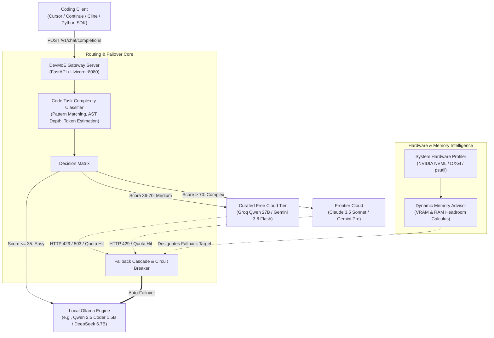

<div align="center">

# ⚡ DevMoE
### Intelligent, Memory-Aware LLM Router for Software Engineering
**Dynamic Hybrid Routing between Local MoE (Ollama) and Curated Free Cloud Tiers**

[](tests/)
[](LICENSE)
[](https://python.org)
[](https://platform.openai.com/docs/api-reference)
[](https://ollama.ai)
[](config.yaml)

<p align="center">
  <a href="#-the-problem">The Problem</a> •
  <a href="#-architecture">Architecture</a> •
  <a href="#-benchmark-results">Benchmarks</a> •
  <a href="#-quickstart">Quickstart</a> •
  <a href="#-ide--agent-setup">IDE Integration</a> •
  <a href="#-hardware-profiler--model-matrix">Hardware Matrix</a> •
  <a href="#-contributing">Contributing</a>
</p>

---

</div>

## 📌 The Problem

When using AI coding assistants (Cursor, VS Code Continue, Cline, Claude Dev, Aider), developers face a persistent dilemma:

1. **Token Waste on Trivial Tasks**: Routing routine queries (regex writing, docstrings, type annotations, syntax error fixes, boilerplate) to cloud frontier models (Claude 3.5 Sonnet, GPT-4o) burns expensive credits and triggers unnecessary rate limits.
2. **Cloud Fragility & Disruptive 429s**: Free tiers (Google AI Studio, Groq, Cerebras) provide fast reasoning, but when rate limits (`HTTP 429`) or quota exhaustion (`HTTP 402/403`) hit, your coding session abruptly breaks.
3. **Hardware-Blind Local Deployments**: Running local LLMs blindly without hardware awareness causes out-of-memory errors, OS paging, or choosing models too small when GPU VRAM is sitting idle.

**DevMoE** solves this by acting as an intelligent, self-hosted proxy between your editor and LLM backends:
- **Heuristic & AST Complexity Engine**: Automatically classifies task difficulty ($0 - 100$).
- **Zero-Cost Routine Execution**: Routes low-complexity tasks to fast local models (`qwen2.5-coder:1.5b`).
- **Cloud Reasoning Delegation**: Routes medium and complex tasks to curated free tiers (Groq Qwen 27B, Google AI Studio Gemini/Gemma) or frontier APIs.
- **Dynamic VRAM-Aware Failover**: The instant a cloud provider trips a rate limit, DevMoE automatically falls back to the **highest-parameter local model** that fits your machine's physical RAM and GPU VRAM.
- **Air-Gapped Mode**: If all cloud endpoints are offline or depleted, the gateway continues functioning 100% locally with zero client downtime.

---

## 🏗️ Architecture



---

## 📊 Live Benchmark & Failover Verification

The table below reflects real execution data from [`test_parallel.py`](test_parallel.py) running on an **NVIDIA GeForce RTX 3050 6GB Laptop GPU + 16 GB RAM**:

```
+-------------------------------------------------------------------------------------------------------+
| Task & Complexity                  | Provider & Model                  | Status   | Latency   | Tokens |
|------------------------------------+-----------------------------------+----------+-----------+--------|
| Task 1: Semver Regex (Easy)        | Groq (qwen/qwen3.8-27b)           | OK       |  1,405 ms |    306 |
| Task 2: REST API & SQL (Medium)    | Local GPU (qwen2.5-coder:1.5b)    | OK       |  5,311 ms |    313 |
|                                    | Groq (qwen/qwen3.8-27b)           | OK       |  2,551 ms |    296 |
| Task 3: Mutex Concurrency (Complex)| Groq Cloud (Free Tier)            | 429 FAIL |    687 ms |      0 |
|                                    | Google AI Studio                  | 503 FAIL |  5,313 ms |      0 |
|                                    | Local GPU (qwen2.5-coder:1.5b)    | OK       |  2,920 ms |    320 |
+-------------------------------------------------------------------------------------------------------+
```

> **Takeaway**: When Groq struck an `HTTP 429` rate limit and Google returned `HTTP 503` under load, DevMoE intercepted the failures and transparently executed the query locally on the user's GPU in **2.92 seconds** without dropping the request.

---

## 💻 Hardware Profiler & Model Matrix

DevMoE dynamically inspects your hardware and scores candidate models from its curated catalog based on current memory headroom:

| Model | Parameters | Required Memory | Specialization | Suitability (16GB RAM + 6GB VRAM) | Ollama Pull Command |
| :--- | :---: | :---: | :--- | :---: | :--- |
| **Qwen 2.5 Coder** | 1.5B | 1.5 GB | Routine Syntax & Typing | `OPTIMAL` (100% VRAM) | `ollama pull qwen2.5-coder:1.5b` |
| **DeepSeek Coder** | 1.3B | 1.4 GB | Fast Code Snippets | `OPTIMAL` (100% VRAM) | `ollama pull deepseek-coder:1.3b` |
| **Google Gemma 2** | 2.6B | 2.2 GB | General Reasoning | `OPTIMAL` (100% VRAM) | `ollama pull gemma2:2b` |
| **Llama 3.2** | 3.2B | 2.8 GB | General & Refactoring | `OPTIMAL` (100% VRAM) | `ollama pull llama3.2:3b` |
| **DeepSeek Coder** | 6.7B | 4.8 GB | **High-Param Code Specialist** | `OPTIMAL` (**Primary Fallback**) | `ollama pull deepseek-coder:6.7b` |
| **Qwen 2.5 Coder** | 7.0B | 5.2 GB | Multi-file Code Generation | `TIGHT FIT` | `ollama pull qwen2.5-coder:7b` |
| **DeepSeek Coder V2**| 16.0B (MoE)| 10.5 GB | Architectural Code Review | `EXCEEDS VRAM` (RAM Only) | `ollama pull deepseek-coder-v2:16b` |
| **Qwen 2.5 Coder** | 32.0B | 22.0 GB | Deep Reasoning | `EXCEEDS RAM` | *(Use Groq Cloud)* |

To inspect your machine's live suitability matrix:
```bash
python run.py recommend
```

---

## 🚀 Quickstart

### 1. Clone & Install

```bash
git clone https://github.com/Rahul-14507/MyLLM.git DevMoE
cd DevMoE
pip install -e .
```

### 2. Configure Keys (Optional)

Copy `.env.example` to `.env`:
```bash
cp .env.example .env
```

Add whatever keys you have available. All cloud providers are optional—DevMoE operates in **100% Autonomous Local Mode** if no keys are provided:

```env
# Free tier from https://console.groq.com/
GROQ_API_KEY=gsk_...

# Free tier from https://aistudio.google.com/
GEMINI_API_KEY=AQ...

# Optional frontier keys
ANTHROPIC_API_KEY=sk-ant-...
OPENAI_API_KEY=sk-...
```

### 3. Pull Recommended Local Models

Ensure [Ollama](https://ollama.ai) is running, then pull the recommended models for your machine:
```bash
# Recommended baseline (fits on consumer GPUs)
ollama pull qwen2.5-coder:1.5b
ollama pull deepseek-coder:6.7b
```

*(Or run `python download_models.py` to pull them interactively).*

### 4. Launch Gateway & Web Dashboard

```bash
python run.py serve --port 8080
```

- **OpenAI-Compatible Base URL**: `http://localhost:8080/v1`
- **Interactive Web Dashboard**: [`http://localhost:8080/dashboard`](http://localhost:8080/dashboard)

---

## 🛠️ CLI Reference

DevMoE includes a full suite of management commands:

```bash
# Inspect host RAM, VRAM, and provider circuit-breaker states
python run.py status

# Run dynamic memory suitability analysis for local models
python run.py recommend

# Test how a prompt is scored and routed without invoking LLM inference
python run.py route "Write a regex pattern to validate email addresses"
python run.py route "Design a distributed consensus system with raft and mutexes"

# Run parallel benchmark across local models and cloud endpoints
python test_parallel.py

# Launch the gateway server
python run.py serve --host 127.0.0.1 --port 8080
```

---

## 🔌 IDE & Client Integration

Because DevMoE exposes an exact OpenAI-compatible endpoint at `/v1/chat/completions`, it works out of the box with any tool that supports a custom base URL.

### Cursor / Windsurf / VS Code Continue
Add DevMoE to your extension settings (`config.json`):

```json
{
  "models": [
    {
      "title": "DevMoE (Intelligent Hybrid Router)",
      "provider": "openai",
      "model": "devmoe-auto",
      "apiBase": "http://localhost:8080/v1",
      "apiKey": "dummy"
    },
    {
      "title": "DevMoE (Forced Local VRAM Fit)",
      "provider": "openai",
      "model": "devmoe-local",
      "apiBase": "http://localhost:8080/v1",
      "apiKey": "dummy"
    }
  ]
}
```

### Aider CLI
```bash
aider --openai-api-base http://localhost:8080/v1 --openai-api-key dummy --model devmoe-auto
```

### Python SDK
```python
from openai import OpenAI

client = OpenAI(
    base_url="http://localhost:8080/v1",
    api_key="dummy"
)

response = client.chat.completions.create(
    model="devmoe-auto",
    messages=[
        {"role": "user", "content": "Write a FastAPI route with SQL pagination"}
    ]
)

print(response.choices[0].message.content)
```

---

## 🖥️ Web Dashboard

DevMoE includes an embedded, zero-dependency dark-mode dashboard running on `/dashboard`:

- **Real-Time Telemetry**: Live host RAM usage, GPU VRAM allocation, and Ollama connection status.
- **Routing Playground**: Paste any code prompt, click presets, and visualize the 4-stage pipeline:
  `Prompt Parsing` $\rightarrow$ `Complexity Engine` $\rightarrow$ `Model Selection` $\rightarrow$ `Failover Cascade`.
- **Circuit Breaker Monitor**: Live provider health, cooldown timers, request counters, and rate-limit event logs.
- **Model Catalog Matrix**: One-click copy commands for all Ollama tags with real-time headroom calculations.

---

## 🧪 Testing

The repository maintains an automated test suite covering hardware bounds, complexity scoring, fallback cascade, and FastAPI routes:

```bash
# Run full test suite
pytest -v

# Run specific test modules
pytest tests/test_classifier.py
pytest tests/test_router_failover.py
pytest tests/test_server.py
```

---

## 🤝 Contributing

We welcome contributions from the open-source community! Whether you want to add a new cloud provider, refine task complexity heuristics, or optimize VRAM allocation logic:

### Adding a New Provider
1. Inherit from `BaseProvider` in [`devmoe/providers/base.py`](devmoe/providers/base.py).
2. Implement `complete()` and `stream_complete()` with error handling for `ProviderRateLimitError` and `ProviderQuotaExhaustedError`.
3. Register the provider in [`devmoe/providers/manager.py`](devmoe/providers/manager.py) and [`config.yaml`](config.yaml).

### Refining Task Complexity Heuristics
Heuristic weights and regex patterns reside in [`devmoe/router/classifier.py`](devmoe/router/classifier.py). Feel free to submit PRs adding patterns for language-specific frameworks (e.g., Tokio in Rust, Goroutines in Go, React concurrency).

### Development Workflow
```bash
# Create feature branch
git checkout -b feature/my-new-feature

# Run tests
pytest

# Format & Lint
ruff check .
```

---

## 🗺️ Roadmap

- [x] Hardware profiling via NVML, DXGI, and psutil
- [x] Software task complexity classifier with signal extraction
- [x] Curated Free Tier adapters (Google AI Studio, Groq Cloud, Cerebras)
- [x] Automatic failover cascade to highest-parameter local VRAM fit
- [x] Autonomous Air-Gapped Mode
- [x] Embedded web dashboard and telemetry playground
- [ ] Semantic embeddings-based micro-classifier for ambiguous prompts
- [ ] Dynamic token budget throttling & monthly quota limits
- [ ] Native vLLM and llama.cpp direct server backends

---

## 📜 Acknowledgments & Inspiration

DevMoE draws direct architectural inspiration from two pioneering projects:
- [**Rahul-14507/MELLM**](https://github.com/Rahul-14507/MELLM): Pioneered lightweight, modular Mixture-of-Experts routing for local LLMs on consumer GPUs.
- [**tashfeenahmed/freellmapi**](https://github.com/tashfeenahmed/freellmapi): Demonstrated unified OpenAI-compatible aggregation and resilience across free-tier endpoints.

---

## ⚖️ License

Distributed under the **Apache License 2.0**. See [`LICENSE`](LICENSE) for details.
