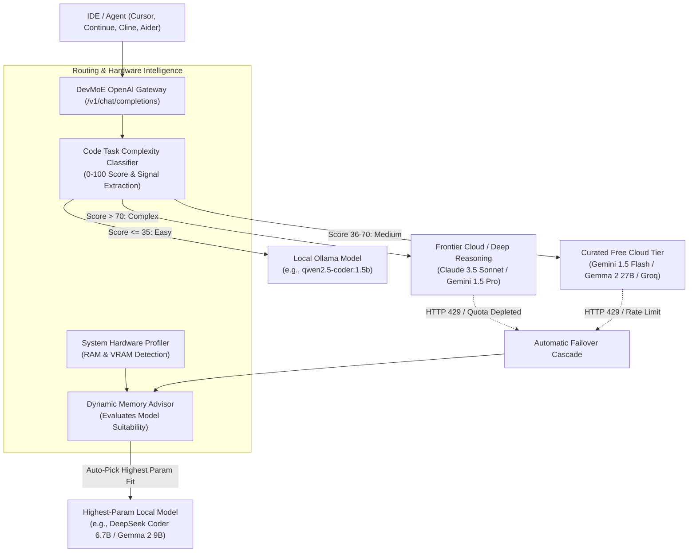

# 🚀 DevMoE: Intelligent Software Development LLM Router

[](LICENSE)
[](https://python.org)
[](https://platform.openai.com/docs/api-reference)
[](https://ollama.ai)
[](https://aistudio.google.com/)

**DevMoE** is an open-source, memory-aware AI routing engine and API gateway built specifically for software engineering workflows. It synthesizes the lightweight local Mixture-of-Experts routing principles from [Rahul-14507/MELLM](https://github.com/Rahul-14507/MELLM) with the unified OpenAI-compatible multi-provider resilience of [tashfeenahmed/freellmapi](https://github.com/tashfeenahmed/freellmapi).

---

## 💡 The Core Philosophy

| Scenario | Challenge | DevMoE Resolution |
| :--- | :--- | :--- |
| **Routine Tasks** (Regex, docstrings, syntax fixes, unit tests) | Wastes expensive cloud tokens and consumes quota | Routes to **zero-cost, ultra-fast Local Ollama models** (Qwen 2.5 Coder, DeepSeek Coder, Gemma 2). |
| **Complex Engineering** (Distributed concurrency, memory safety, system design) | Requires deep algorithmic reasoning | Routes to **Curated Free Cloud Tiers** (Google AI Studio Gemma 2 27B / Gemini 1.5 Flash) or Frontier APIs (Claude 3.5 Sonnet / Gemini 1.5 Pro). |
| **Cloud Rate Limit (HTTP 429 / Quota Hit)** | Developer clients fail or crash | **Instant Dynamic Failover**: Automatically catches rate limits and cascades to the **highest-parameter local model** that fits in current host RAM/VRAM! |
| **Free Tier Depletion / Offline Dev** | Complete cloud lockout | **Autonomous Air-Gap Mode**: Seamlessly switches to 100% local model execution with zero client interruption. |

---

## 🏗️ Architecture Overview



---

## ⚡ Key Features

1. **Intelligent Software Task Classifier**:
   - Analyzes prompt length, keyword domain signals (concurrency, distributed consensus, memory safety, AST transforms vs. regex, docstrings, boilerplate).
   - Generates a complexity score ($0 - 100$) and assigns a tier (`EASY`, `MEDIUM`, `COMPLEX`).

2. **Hardware Profiler & Dynamic Memory Advisor**:
   - Inspects physical Host RAM and GPU VRAM in real-time.
   - Calculates memory headroom for each model in the catalog (`OPTIMAL`, `RECOMMENDED`, `TIGHT FIT`, `EXCEEDS RAM`).
   - Automatically designates the **Highest-Parameter Local Fallback Candidate** that safely runs on the host without OS swapping.

3. **Curated Indefinite Free Cloud Providers**:
   - Unlike proxies that aggregate dozens of unreliable or unvetted endpoints, DevMoE focuses on developer-grade free tiers:
     - **Google AI Studio**: Gemini 1.5 Flash, Gemini 1.5 Pro, and official Google Gemma 2 (`gemma-2-27b-it`, `gemma-2-9b-it`).
     - **Groq Cloud Free Tier**: Lightning-fast Qwen 2.5 Coder 32B & Llama 3.3 70B.
     - **Cerebras Cloud Free Tier**: Ultra-fast Llama 3.1 70B inference.
     - **Frontier Cloud (Optional)**: Claude 3.5 Sonnet, OpenAI GPT-4o.

4. **Circuit Breaker & Live Token Tracker**:
   - Real-time detection of HTTP 429 (rate limits) and HTTP 402/403 (quota depletion).
   - Configurable cooldown windows (default 60s) before attempting upstream retry.
   - Real-time token accounting per provider.

5. **Modern Interactive Web Dashboard**:
   - Embedded UI at `http://localhost:8080/dashboard`.
   - Real-time host memory gauges (RAM, VRAM, CPU cores).
   - Visual interactive routing flowchart.
   - Routing sandbox / playground with presets (Regex, FastAPI, Raft Concurrency, Syntax Fixes).
   - Model recommendation matrix with one-click `ollama run <tag>` copy buttons.

---

## 🛠️ Quickstart

### 1. Installation

```bash
git clone https://github.com/Rahul-14507/DevMoE.git
cd DevMoE
pip install -e .
```

### 2. Configure Keys (Optional)

Copy `.env.example` to `.env`:

```bash
cp .env.example .env
```

Add any keys you wish to use (all cloud providers are optional):

```env
# Free key from https://aistudio.google.com/
GEMINI_API_KEY=your_gemini_key_here

# Free key from https://console.groq.com/
GROQ_API_KEY=your_groq_key_here

# Optional Claude key
ANTHROPIC_API_KEY=your_anthropic_key_here
```

> **Note**: If no cloud keys are provided, DevMoE automatically operates in **100% Autonomous Local Ollama Mode**.

### 3. Launch the Server & Dashboard

```bash
python run.py serve --port 8080
```

- **Open Web Dashboard**: [`http://localhost:8080/dashboard`](http://localhost:8080/dashboard)
- **OpenAI Compatible Endpoint**: `http://localhost:8080/v1`

---

## 💻 CLI Commands

DevMoE includes a command-line interface:

### System & Memory Status
```bash
python run.py status
```

### Memory Model Advisor Matrix
```bash
python run.py recommend
```

### Simulate Prompt Routing
```bash
python run.py route "Design a distributed consensus mechanism with mutex deadlock prevention"
```

---

## 🔌 IDE & Coding Agent Setup

### Cursor / Windsurf / VS Code Continue
Add DevMoE as a custom OpenAI-compatible provider:

```json
{
  "models": [
    {
      "title": "DevMoE (Auto Hybrid Router)",
      "provider": "openai",
      "model": "devmoe-auto",
      "apiBase": "http://localhost:8080/v1",
      "apiKey": "dummy"
    },
    {
      "title": "DevMoE (Local High-Param Only)",
      "provider": "openai",
      "model": "devmoe-local",
      "apiBase": "http://localhost:8080/v1",
      "apiKey": "dummy"
    }
  ]
}
```

### Python OpenAI Client
```python
from openai import OpenAI

client = OpenAI(
    base_url="http://localhost:8080/v1",
    api_key="dummy"
)

response = client.chat.completions.create(
    model="devmoe-auto",
    messages=[
        {"role": "user", "content": "Write a regex to validate semantic versions"}
    ]
)

print(response.choices[0].message.content)
print(response._devmoe_meta)  # Access complexity score and routed provider
```

---

## 🧪 Running Tests

The test suite validates hardware detection, memory advisor bounds, complexity classification, rate-limit fallback cascade, and FastAPI server endpoints:

```bash
pytest -v
```

---

## 📄 License

Apache License 2.0. Built for developers, open source contributors, and AI engineers.
